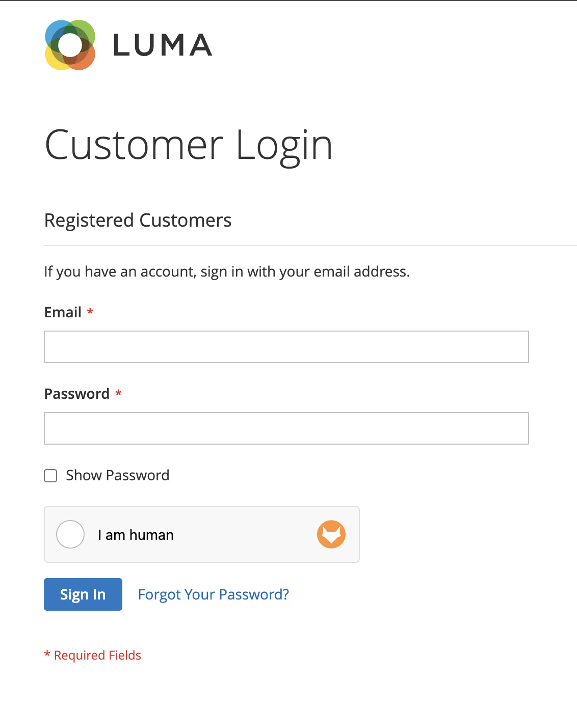

# CaptchaFox for Magento and Adobe Commerce

Official [CaptchaFox](https://captchafox.com) integration for Magento Open Source and Adobe Commerce. It
renders the CaptchaFox widget in the storefront and admin forms you choose and verifies every answer on
the server.

<p align="center">
  
</p>

## Compatibility

| Magento Open Source / Adobe Commerce | Module | PHP |
|---|---|---|
| 2.4.4 or later | 1.x | 8.1 or later |

Magento 2.4.3 and earlier are not supported.

## Installation

In the Magento root folder:

```bash
composer require captchafox/magento
bin/magento setup:upgrade
```

In production mode, also run `bin/magento setup:di:compile` and `bin/magento setup:static-content:deploy`.

Without Composer, copy the files of a [release](https://github.com/CaptchaFox/magento-captchafox/releases)
into `app/code/CaptchaFox/Core` and run the same `bin/magento` commands.

## Configuration

### Get your keys

In the [CaptchaFox portal](https://portal.captchafox.com), open your website under **Sites > Site
Details** and copy the **site key** and the **secret key**.

### Set up the module

Go to **Stores → Configuration → Services → CaptchaFox**:

1. Under **Settings**, enter the **Site key** and the **Secret key**.
2. Under **Storefront**, set **Enabled** to **Yes** and select the forms in **Forms to validate**.
3. Under **Admin Panel**, do the same for the admin forms.
4. Click **Save Config** and refresh the caches that Magento lists as invalidated.

### Options

| Option | Default | Meaning |
|---|---|---|
| Storefront → Enabled | No | CaptchaFox in the storefront |
| Storefront → Theme | light | light or dark |
| Storefront → Mode | inline | inline or popup |
| Storefront → Language Code | -- Auto Detected -- | Language of the widget |
| Storefront → Forms to validate | none | See [Usage](#usage) |
| Storefront → Skip validation for logged in customers | No | Yes: no widget and no check for logged-in customers |
| Admin Panel → Enabled, Theme, Mode, Language Code | No, light, inline, -- Auto Detected -- | As for the storefront |
| Admin Panel → Forms to validate | none | See [Usage](#usage) |

### Turn off Magento's own captchas

So that a form does not show two captchas, turn off the captchas that Magento brings for the forms
CaptchaFox protects:

- **Stores → Configuration → Customers → Customer Configuration → CAPTCHA:** set **Enable CAPTCHA on
  Storefront** to **No**.
- **Stores → Configuration → Security → Google reCAPTCHA Storefront → Storefront:** set **Enable for
  Customer Login**, **Enable for Forgot Password**, **Enable for Create New Customer Account**,
  **Enable for Contact Us** and **Enable for Product Review** to **No**.
- **Stores → Configuration → Security → Google reCAPTCHA Admin Panel → Admin Panel:** set **Enable for
  Login** and **Enable for Forgot Password** to **No**.

To remove Magento's reCAPTCHA modules entirely, list them under `replace` in the `composer.json` of
your project:

```json
{
  "replace": {
    "magento/module-re-captcha-admin-ui": "*",
    "magento/module-re-captcha-checkout": "*",
    "magento/module-re-captcha-checkout-sales-rule": "*",
    "magento/module-re-captcha-contact": "*",
    "magento/module-re-captcha-customer": "*",
    "magento/module-re-captcha-frontend-ui": "*",
    "magento/module-re-captcha-gift-card": "*",
    "magento/module-re-captcha-invitation": "*",
    "magento/module-re-captcha-migration": "*",
    "magento/module-re-captcha-multiple-wishlist": "*",
    "magento/module-re-captcha-newsletter": "*",
    "magento/module-re-captcha-paypal": "*",
    "magento/module-re-captcha-review": "*",
    "magento/module-re-captcha-send-friend": "*",
    "magento/module-re-captcha-store-pickup": "*",
    "magento/module-re-captcha-ui": "*",
    "magento/module-re-captcha-user": "*",
    "magento/module-re-captcha-validation": "*",
    "magento/module-re-captcha-validation-api": "*",
    "magento/module-re-captcha-version-2-checkbox": "*",
    "magento/module-re-captcha-version-2-invisible": "*",
    "magento/module-re-captcha-version-3-invisible": "*",
    "magento/module-re-captcha-webapi-api": "*",
    "magento/module-re-captcha-webapi-graph-ql": "*",
    "magento/module-re-captcha-webapi-rest": "*",
    "magento/module-re-captcha-webapi-ui": "*"
  }
}
```

### Theme and mode of a single form

A layout file of your theme can set the theme and the mode of one form, for example of the customer
login:

```xml
<?xml version="1.0"?>
<!-- layout/customer_account_login.xml -->
<page xmlns:xsi="http://www.w3.org/2001/XMLSchema-instance" xsi:noNamespaceSchemaLocation="urn:magento:framework:View/Layout/etc/page_configuration.xsd">
    <body>
        <referenceContainer name="form.additional.info">
            <block name="captchafox.login">
                <action method="setMode">
                    <argument name="mode" xsi:type="string">popup</argument>
                </action>
                <action method="setTheme">
                    <argument name="theme" xsi:type="string">dark</argument>
                </action>
            </block>
        </referenceContainer>
    </body>
</page>
```

## Usage

CaptchaFox protects the forms selected in **Forms to validate**:

| Storefront | Form |
|---|---|
| `contact` | Contact Us |
| `register` | Create New Customer Account |
| `login` | Customer Login |
| `login-ajax` | Login popup and login in the email step of the checkout |
| `password` | Forgot Your Password? |
| `review` | Product review |
| `send-friend` | Email to a Friend |
| `newsletter` | Newsletter subscription |

| Admin Panel | Form |
|---|---|
| `login` | Admin login |
| `password` | Forgot your password? |

### Choose where CaptchaFox is used

Select the forms in **Forms to validate** of the Storefront and of the Admin Panel. No form is
selected by default. The selection can differ per website and store view.

### How a form is checked

- **On the server:** Before Magento processes a selected form, the module verifies the answer with
  CaptchaFox. A form without an answer, or with an answer that CaptchaFox rejects, is not processed;
  the visitor sees "Security validation error: …".
- **Web API:** The same forms are checked when a headless storefront sends them through Magento's
  web API: by REST, creating an account, requesting a password reset and creating a customer token; by
  GraphQL, the mutations of all storefront forms except `login-ajax`. The client sends the answer of
  the widget in the header `X-CaptchaFox`. Requests of integrations and admin users are not checked,
  nor are requests of customers when **Skip validation for logged in customers** is on.

## Operation

### Visitor IP

The module sends CaptchaFox only the answer of the widget and the secret key, not the visitor's IP
address. Reverse proxies and load balancers need no setup.

### Content Security Policy

The module adds CaptchaFox to Magento's own Content Security Policy (`etc/csp_whitelist.xml`). Only a
policy sent outside Magento, for example by the web server or a CDN, needs these directives added by
hand. Keep your existing values such as `'self'`, which the module's own scripts need.

| Directive | Add |
|---|---|
| `script-src` | `https://*.captchafox.com blob:` |
| `connect-src` | `https://*.captchafox.com` |
| `style-src` | `https://*.captchafox.com` |
| `img-src` | `https://*.captchafox.com` |
| `media-src` | `https://*.captchafox.com` |

- If you set `worker-src` or `child-src`, add `blob:` there as well. The widget runs a web worker from
  a `blob:` URL.
- The widget script is loaded from `https://cdn.captchafox.com/api.js`. It cannot be bundled or
  self-hosted, and Subresource Integrity (SRI) is not possible because its URL is not versioned.

### Privacy

CaptchaFox is operated by Scoria Labs GmbH, Germany. How CaptchaFox processes data and how to get a
data processing agreement is described in the [CaptchaFox Privacy Center](https://captchafox.com/privacy).
A suggested paragraph for your privacy policy is on the
[GDPR page](https://captchafox.com/privacy/gdpr).

## Troubleshooting

### "Unable to secure the form. The site key is missing."

The site key is missing. Enter it under **Settings**.

### "Unable to secure the form"

The widget could not be rendered. Check the site key, and that the browser may load
`https://*.captchafox.com` (see [Content Security Policy](#content-security-policy)).

### "Security validation error: …"

Magento did not process the form. The end of the message names the reason:

| Message ends with | Cause and fix |
|---|---|
| "… please complete the security field …" or "… please validate the security field …" | The form was sent without an answer. Solve the widget, then send the form. |
| "… the response parameter is invalid or has expired." | The answer was too old. Solve the widget again. |
| "… the response parameter has already been validated before." | The answer was already used. Solve the widget again. |
| "… the secret key is missing." | Enter the secret key under **Settings**. |
| "… the secret parameter was invalid or did not exist." | The secret key is wrong. Copy it again from the CaptchaFox portal. |

### No widget appears in production mode

In production mode Magento hides errors that occur while a block renders and only logs them. Check
`var/log/system.log`.

## License

MIT. See [LICENSE](LICENSE).

## Credits

Thanks to [Pixel-Open](https://github.com/Pixel-Open) for the base implementation.
